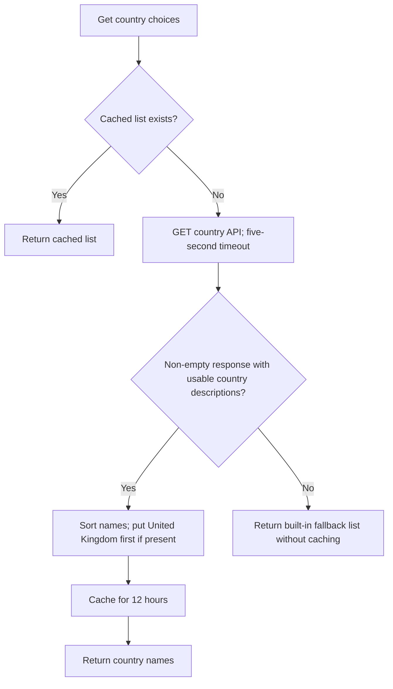

# Country choices

`get_country_choices()` in `app/lib/get_country_choices.py` supplies the country names used in the requester's address form. It fetches them from the Record Copying Service API, caches successful results, and uses a built-in list if the API cannot supply them.

## Fetching and ordering countries

The function first checks the application cache for the key `country_choices`. If a cached value exists, it returns that value without calling the API.

Otherwise, it sends an HTTP GET to `COUNTRY_API_URL` with a five-second timeout. The expected response is a JSON list of objects with a `Description` field:

```json
[
  { "Description": "United Kingdom", "Code": "GB" },
  { "Description": "France", "Code": "FR" }
]
```

Only `Description` is used; country codes are ignored. The country names are sorted alphabetically, then `United Kingdom` is moved to the top if it is present. The function does not add it if the API omits it.

The resulting list is cached for **12 hours** (43,200 seconds) and returned.



## Fallback behaviour

If the request fails, returns an HTTP error, or the response cannot be decoded or read in the expected format, the function logs:

```text
Failed to fetch country choices from the API. Using default.
```

It then returns `FALLBACK_COUNTRY_CHOICES` from `app/constants.py`. An empty response also returns this list, but does not log an error.

The fallback list is returned in its stored order, with `United Kingdom` first. It is **not cached**, so the next call without a cached result attempts the API again.

## Using the choices in the address form

`WhatIsYourAddress` in `app/main/forms/what_is_your_address.py` calls the function when the form is constructed. It appends the returned names after the country field's initial selection prompt.

The country name is both the option label and submitted value, rather than an ISO country code. The `country_must_be_selected` validator rejects the initial prompt so that the user must select a country.

## Configuration and local development

`config.py` builds `COUNTRY_API_URL` by appending `GetCountry` to the `RECORD_COPYING_SERVICE_API_URL` environment variable. The base URL must include the separator needed before `GetCountry`, normally a trailing slash.

The test configuration points to `http://mock-record-copying-service-api:8080/GetCountry`. Its WireMock response is defined in `wiremock/mappings/get-country.json` and includes example country descriptions and codes.
