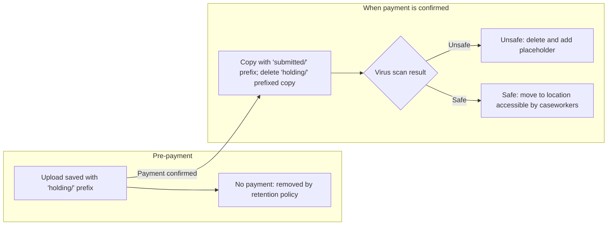

# Moving proof of death files after payment (S3)

The holding and submitted S3 prefixes have different purposes: 

- `holding/` contains uploads awaiting payment
- `submitted/` means the file can be scanned and further processed. 

Moving a file after payment separates unpaid uploads, which are removed by the retention policy, from files that should be processed.

After payment is confirmed, the application copies the object to the configured submitted prefix (by default, `submitted/`) and then deletes the holding copy. If the move fails, it logs a warning and continues processing the request.

## Virus scanning and hand-off

Files under `submitted/` are virus scanned and tagged as safe or unsafe. A Lambda function then handles the scan result:

- **Unsafe:** the file is deleted and replaced with a placeholder explaining that it was removed because of a virus scan.
- **Safe:** the file is moved to the bucket root, where it will be available to caseworkers in an image viewer.

The holding and submitted prefixes can be configured with `PROOF_OF_DEATH_HOLDING_PREFIX` and `PROOF_OF_DEATH_SUBMITTED_PREFIX`. See [Proof of death uploads to S3](proof-of-death-uploads.md) for the upload process and S3 configuration.
