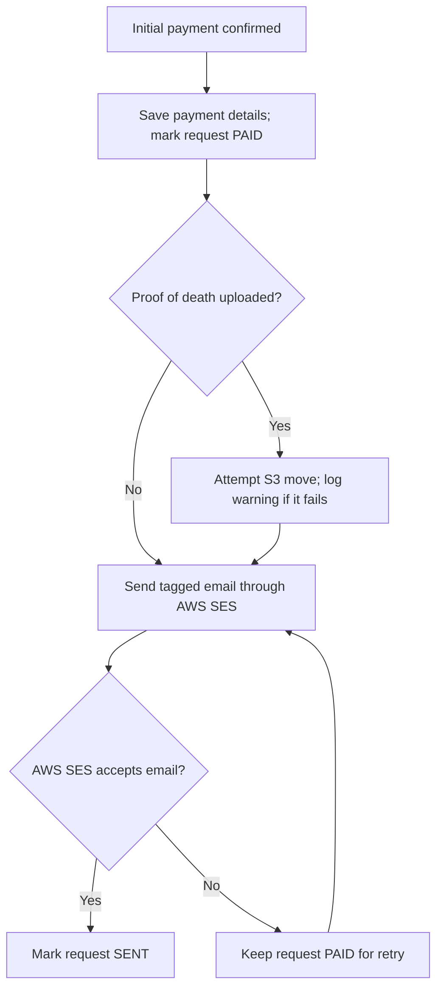

# Sending data to Dynamics

Service record requests are sent as plain-text emails through AWS SES to the configured Dynamics inbox.

The request email is generated by `app/lib/dynamics_handler.py`. It contains:

1. a subject that Dynamics uses to classify the request and trigger automated workflows
2. a body containing named tags.

## When a request is sent

After GOV.UK Pay confirms a successful initial payment, `process_valid_request` in `app/lib/gov_uk_pay.py`:

1. Saves the payment provider ID, reference, amount and processing date, and marks the request as `PAID`.
2. Attempts to move any uploaded proof of death from the holding prefix to the submitted prefix in S3.
3. Sends the request email to `DYNAMICS_INBOX`.
4. Marks the request as `SENT` if AWS SES accepts the email.

A failed file move logs a warning but does not prevent the email from being sent. See [File movement after payment](proof-of-death-file-movement.md) for scanning and file availability.



`SENT` means the email was accepted by AWS SES, **not that Dynamics has confirmed importing or processing it**.

## Email subject

The subject has this format:

```text
? FOI DIRECT MOD {closure status}{processing option}
```

The processing-option suffix is `1` for a Standard order and `2` for a Full record check.

| Closure status | When it is used                                                            |
| -------------- | -------------------------------------------------------------------------- |
| `FOIOP`        | Open record: birth year is before the current year minus 115.              |
| `FOICD`        | Closed record where proof of death **is either supplied or not required**. |
| `FOICDN`       | Closed record where proof of death **is required but not supplied**.       |

The business rules relating to the requirement for a proof of death are covered in [Proof of death](../business-rules/proof-of-death.md).

## Email body

The body contains one `<tag>value</tag>` per line, in the order defined by `DYNAMICS_REQUEST_FIELD_MAP`.

| Email tag                        | Stored request field               |
| -------------------------------- | ---------------------------------- |
| `mandatory_forename`             | `requester_first_name`             |
| `mandatory_surname`              | `requester_last_name`              |
| `mandatory_email`                | `requester_email`                  |
| `mandatory_address1`             | `requester_address1`               |
| `address2`                       | `requester_address2`               |
| `mandatory_town`                 | `requester_town_city`              |
| `county`                         | `requester_county`                 |
| `postcode`                       | `requester_postcode`               |
| `mandatory_country`              | `requester_country`                |
| `mandatory_certificate_forename` | `forenames`                        |
| `mandatory_certificate_surname`  | `last_name`                        |
| `mandatory_birth_date`           | `date_of_birth`                    |
| `birth_place`                    | `place_of_birth`                   |
| `service_number`                 | `service_number`                   |
| `regiment`                       | `regiment`                         |
| `mandatory_upload_file_name`     | `proof_of_death`                   |
| `enquiry`                        | `additional_information`           |
| `mandatory_catalogue_reference`  | `catalogue_reference`              |
| `certificate_othernames`         | `other_last_names`                 |
| `date_of_death`                  | `date_of_death`                    |
| `mod_barcode_number`             | `mod_reference`                    |
| `service_branch`                 | `service_branch`                   |
| `commissioned_officer`           | `were_they_a_commissioned_officer` |
| `died_in_service`                | `died_in_service`                  |
| `prior_contact_reference`        | `case_reference_number`            |
| `payment_date`                   | `payment_date`                     |
| `delivery_type`                  | `delivery_type`                    |
| `process_type`                   | `processing_option`                |
| `payment_reference`              | `payment_reference`                |
| `amount_received`                | `amount_received`                  |
| `provider_id`                    | `provider_id`                      |

## Retrying unsuccessful sends

`retry_paid_requests.py` is intended to be run as a cron job. It resends request emails for service record requests still marked as `PAID`, in creation order, and marks successfully sent entries as `SENT`. It sends the email only; it does not repeat the S3 file move.

The email send and database update are separate operations. If a send succeeds but saving `SENT` fails, a later retry can send the same data again.

## Configuration

| Setting              | Purpose                                                     |
| -------------------- | ----------------------------------------------------------- |
| `DYNAMICS_INBOX`     | Recipient of service record request emails.                 |
| `EMAIL_FROM`         | Sender email address used by AWS SES.                       |
| `EMAIL_FROM_NAME`    | Sender display name used by AWS SES.                        |
| `AWS_DEFAULT_REGION` | AWS region used by the SES client; defaults to `eu-west-2`. |
