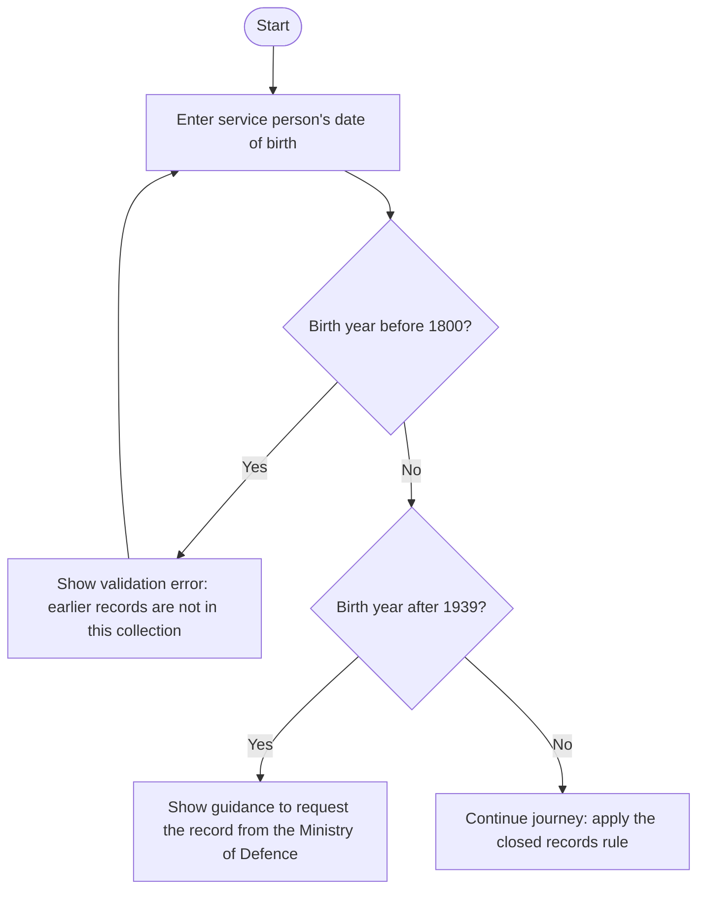

# Birth years covered

The application uses constants to define the birth years covered by the service: **1800 to 1939 inclusive**.

## Earliest birth year

`EARLIEST_SERVICE_PERSON_BIRTH_YEAR_FOR_THIS_SERVICE` is **1800**.

The `BornTooEarly` validator on the date-of-birth form rejects dates before 1 January 1800. The user sees
a validation error explaining that earlier records are not in this collection and cannot continue with
that date.

## Latest birth year

`LATEST_SERVICE_PERSON_BIRTH_YEAR_FOR_THIS_SERVICE` is **1939**.

After the date-of-birth form validates, the state machine's `born_too_late` condition checks whether the
birth year is greater than 1939. If so, the user is routed to “We do not have records for people born after
1939” and directed to request the record from the Ministry of Defence. Unlike the earliest-year rule,
this is a routing decision rather than a form validation error because there is additional information the
user will need.

## Decision flow

The diagram focuses on the birth year limits; the date must also pass the form's other date validations.

