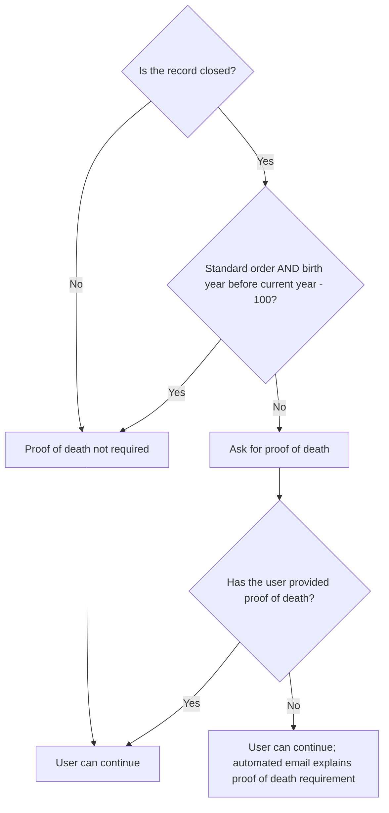

# Proof of death

## Why we ask for proof of death for closed record requests

To protect personal data that might relate to a living person, we ask users to provide proof of death for [closed records](closed-records.md).

## When a proof of death is not required for a closed record

Standard orders for closed records do not require proof of death when the service person's birth **year** falls within this range:

```text
IF birth year is on or after (current year - 115)
AND birth year is before (current year - 100)
THEN proof of death is not required for a Standard order
```

Proof of death is required for Standard orders when the birth year is **in or after** `current year - 100`. For Full record checks, proof of death is required for all closed records.

!!! tip "These are calendar-year comparisons"
The day and month of birth are not part of the calculation. For example, in 2026, Standard orders for closed records with birth years from 1911 to 1925 inclusive do not require proof of death. Standard orders with birth years of 1926 or later require it.

## Users can proceed without uploading proof of death

It is a requirement of Freedom of Information (FOI) legislation that users can submit a request without providing proof of death.

If proof of death is required and the user does not provide it, they can still continue. In this scenario an automated email is sent to the user explaining the requirement for a proof of death.

## Flowchart


