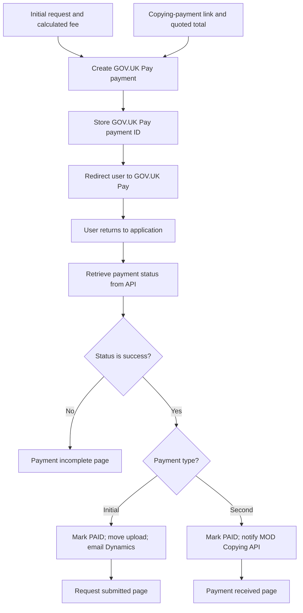

# GOV.UK Pay

The application uses GOV.UK Pay for:

1. the **initial payment** when submitting a service record request
2. the **second payment** for copying following a Full record check.

Both flows create a payment through the API, redirect the user to GOV.UK Pay, then retrieve the payment status from the API when the user returns.

## Creating a payment

`create_payment()` in `app/lib/gov_uk_pay.py` sends an HTTP POST to `GOV_UK_PAY_API_URL`, using bearer authentication configured through `GOV_UK_PAY_API_KEY`.

| Field         | Initial payment                                             | Second payment                                        |
| ------------- | ----------------------------------------------------------- | ----------------------------------------------------- |
| `amount`      | Calculated upfront fee, in pence.                           | Quoted copying and delivery total, in pence.          |
| `description` | Application title from content.                             | Case number, followed by payment details if supplied. |
| `reference`   | Generated reference: `TNA`, UTC date (`YYYYMMDD`) and UUID. | Reference supplied with the copying-payment request.  |
| `email`       | Requester's email, when present.                            | Payee's email.                                        |
| `return_url`  | HTTPS callback identifying the service record request.      | HTTPS callback identifying the payment attempt.       |

The response must include `payment_id` and `_links.next_url.href`. The application stores the payment ID before redirecting the user to the returned URL. An unsuccessful creation or missing response fields directs the user to the payment-link-creation-failed page.

## Initial payment

`app/main/routes/request_payment_routes.py` handles the initial payment through `/send-to-gov-uk-pay/`.

The application validates the required session data, transforms it into a request record and calculates the amount. See [Price calculations](../business-rules/price-calculations.md) for fees and delivery charges.

A `ServiceRecordRequest` stores the request details and GOV.UK Pay payment ID. Its internal UUID identifies the request in the return URL.

### Existing payment checks

The application hashes the transformed form data to identify an existing request. It checks that request's GOV.UK Pay status before creating another payment:

| GOV.UK Pay status                 | Behaviour                                                        |
| --------------------------------- | ---------------------------------------------------------------- |
| `success`                         | Redirect to the request-submitted page.                          |
| `created`, `started`, `submitted` | Redirect to the existing payment's card-details page.            |
| `failed`, `cancelled`, `error`    | Delete the stored request and allow a new payment to be created. |

These checks apply to the initial-payment flow, not the second-payment flow.

### After successful payment

`process_valid_request()` records the provider ID, payment reference, amount in pounds and UTC processing date, then marks a new request as `PAID`.

It attempts to move any proof of death upload to the submitted S3 prefix and sends the request email to Dynamics. A failed file move logs a warning but does not block the email. If SES accepts the email, the request becomes `SENT`; otherwise it remains `PAID`.

The callback clears the session and redirects to the request-submitted page. See [Sending data to Dynamics](sending-to-dynamics.md) and [Proof of death file movement](proof-of-death-file-movement.md) for downstream processing.

## Second payment

`app/main/routes/dynamics_payment_routes.py` handles payment requests for copying.

An HTTP POST to `/create-payment/` creates a `DynamicsPayment` and emails the customer a link to `/payment/<id>/`.

| Required fields                                         | Optional fields                                         |
| ------------------------------------------------------- | ------------------------------------------------------- |
| `case_number`, `reference`, `net_amount`, `payee_email` | `delivery_amount`, `first_name`, `last_name`, `details` |

Incoming amounts are in pounds and must have no more than two decimal places. The net amount must be positive; delivery must be zero or greater. Amounts are converted to pence, and the total is the net amount plus delivery. Missing delivery defaults to zero.

A duplicate reference is rejected. If sending the payment-link email fails, the newly created payment record is deleted.

### Creating the GOV.UK Pay attempt

For a payment marked as `NEW`, the customer sees the second-payment summary. Continuing redirects through `/gov-uk-pay-redirect/<id>/`, which creates the GOV.UK Pay payment.

A separate `GOVUKDynamicsPayment` record stores each created attempt, linking its GOV.UK Pay payment ID to the `DynamicsPayment`. The callback identifies this attempt rather than the underlying copying-payment request.

### After successful payment

`process_valid_payment()` marks the copying payment as `PAID` and saves its provider ID and UTC processing time. It then sends confirmation to the MOD Copying API. A successful send changes the payment to `SENT`; a reported HTTP error leaves it as `PAID`.

The user is redirected to the payment-received confirmation page. See [Copying-payment confirmations](copying-payment-confirmations.md) for the payload and retry process.

## Checking payment on return

Both flows use:

```text
/handle-gov-uk-pay-response/<payment_type>/<id>/
```

The payment type is `service_record` for initial payments and `dynamics` for second-payment attempts.

The callback looks up the stored GOV.UK Pay payment ID and retrieves the payment using `GOVUKPayAPIClient`. **Only `state.status = success` is treated as successful.** All other returned statuses redirect to the payment-incomplete page.

Invalid payment types return HTTP 400; missing local records return HTTP 404. If the API client returns no payment data, the callback returns HTTP 502. API exceptions are raised by the shared JSON API client rather than handled by this callback.



## Payment and delivery status

GOV.UK Pay's status describes the payment. The application's `PAID` and `SENT` statuses describe payment processing and downstream notification:

- `PAID`: payment has been recorded, but downstream sending is not yet recorded as successful.
- `SENT`: the Dynamics email or MOD Copying API confirmation was successfully sent.

Paid entries that have not been sent can be retried using `retry_paid_requests.py` or `retry_paid_dynamics_payments.py`. These scripts retry downstream notifications, not charging the customer.

The callback logs database and value errors during successful-payment processing but still redirects to the relevant confirmation page. A confirmation page therefore does not guarantee that downstream processing completed.

## Configuration

| Setting              | Purpose                                                                              |
| -------------------- | ------------------------------------------------------------------------------------ |
| `GOV_UK_PAY_API_URL` | Payment API endpoint used to create payments and retrieve their status.              |
| `GOV_UK_PAY_API_KEY` | Credential used for bearer authentication; must not appear in documentation or logs. |
